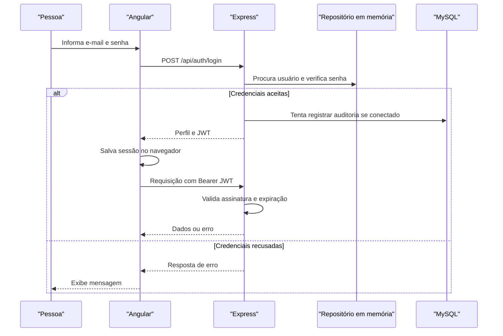

# ConstruTec - Documentacao Completa

**Versão:** 2.0
**Escopo:** comportamento observado no código do repositório, não uma garantia de segurança ou de funcionamento em produção.

## 1. O que o sistema faz

O ConstruTec é uma aplicação para estimar materiais e custos de construção, organizar vários cálculos em um orçamento, consultar o histórico e imprimir um relatório. Possui catálogo regional, contas comuns e painel administrativo. Os resultados são **estimativas**: rendimentos, desperdício e preços podem variar; estruturas, fundações, solo, frete, impostos e especificações executivas precisam de avaliação profissional.

A interface usa Angular 19, TypeScript, RxJS, Tailwind/CSS e ícones Lucide. A API usa Node.js, Express e TypeScript; o MySQL é acessado por `mysql2/promise`, sem ORM. A segurança de senhas usa `bcryptjs`; a sessão usa JWT. O mesmo processo full-stack serve a API e a interface.

## 2. Mapa geral da aplicação

```text
Navegador
  Angular: componentes -> serviços -> HttpClient -> interceptor JWT
    -> requisição HTTP /api
      Express -> rotas -> middleware -> controller
        -> serviço de cálculo, repositório em memória, MySQL ou e-mail
    <- JSON de resposta
  Angular atualiza signals, observables e a tela
```

Essa é uma visão geral, não uma sequência obrigatória para todas as requisições: uma consulta ao catálogo pode usar dados em memória; cálculo usa o serviço próprio; salvar orçamento consulta o MySQL; e o e-mail passa pelo Nodemailer. A aplicação também possui dados em memória e cache no navegador, que não são equivalentes ao banco.

### Inicialização passo a passo

1. Na raiz, `npm run dev` executa [`server.ts`](../server.ts), que cria o Express por meio de [`app.ts`](../backend/construtec-api/src/app.ts), tenta conectar ao banco e, se conectado, chama a sincronização do repositório.
2. Em desenvolvimento, o Vite funciona como middleware do Express. Em produção, `npm run build` gera `dist` e `npm start` executa o servidor compilado, que serve a interface e mantém `/api`. O servidor full-stack escuta na **porta 3000**, inclusive em `0.0.0.0`; isso não publica a aplicação na internet por si só.
3. [`index.html`](../index.html) fornece o documento inicial; [`main.ts`](../frontend/construtec-web/src/main.ts) inicia o Angular. [`app.config.ts`](../frontend/construtec-web/src/app/app.config.ts) registra roteador e interceptor; [`app.routes.ts`](../frontend/construtec-web/src/app/app.routes.ts) mapeia URLs para componentes.
4. [`app.component.ts`](../frontend/construtec-web/src/app/app.component.ts) monta cabeçalho, menu, rodapé, páginas e modais globais. Inicializa a detecção de região; se houver sessão restaurada, tenta validá-la e carregar orçamentos.
5. A inicialização da API standalone em [`backend/construtec-api/src/server.ts`](../backend/construtec-api/src/server.ts) é separada e aceita `PORT`; não confundir com a porta fixa do servidor full-stack da raiz.

### Banco e sincronização

[`config/database.ts`](../backend/construtec-api/src/config/database.ts) cria o pool MySQL, tenta criar o banco e garantir tabelas e colunas necessárias. A tentativa de criar o banco pode falhar por falta de privilégios; a verificação de schema registra avisos. Portanto, **estado conectado não prova que todas as tabelas e migrações estão corretas**.

[`data.repository.ts`](../backend/construtec-api/src/repositories/data.repository.ts) mantém listas em memória de usuários, materiais, tipos, orçamentos, obras, histórico e solicitações. Ao conectar, `syncDataFromMySQL` carrega dados do banco; para algumas tabelas vazias, tenta inserir dados iniciais em memória. Dados fictícios de orçamento antigos são filtrados. Alterações externas no MySQL não aparecem necessariamente nas listas imediatamente: o login comum e várias consultas leem as listas em memória, não consultam o MySQL em toda requisição.

Sem banco, existem dados iniciais de demonstração e parte da aplicação continua funcionando em memória; dados de memória se perdem ao reiniciar. Não trate esse modo como persistência nem como uma réplica segura do banco. Salvar e editar orçamentos e recuperar senha exigem banco. Alguns caminhos de cadastro e administração têm comportamento de contingência descrito adiante.

## 3. Login: da tela até a resposta

O formulário fica principalmente em [`auth-modal.component.ts`](../frontend/construtec-web/src/app/shared/components/auth-modal.component.ts); `/login` abre esse modal usando [`auth-page.component.ts`](../frontend/construtec-web/src/app/features/auth/auth-page.component.ts). O caminho típico é:

1. A pessoa informa e-mail e senha. [`AuthService`](../frontend/construtec-web/src/app/core/services/auth.service.ts) verifica o formato do e-mail e o mínimo de seis caracteres para a senha e envia `POST /api/auth/login` com JSON.
2. [`api.routes.ts`](../backend/construtec-api/src/routes/api.routes.ts) encaminha a requisição para `login` em [`auth.controller.ts`](../backend/construtec-api/src/controllers/auth.controller.ts). O controller normaliza e valida a entrada, procura a conta em `usersStore`, verifica se está ativa e compara a senha.
3. [`security.ts`](../backend/construtec-api/src/utils/security.ts) compara hashes bcrypt; novos hashes usam custo 10. Há compatibilidade legada com SHA-256 e texto plano. Isso descreve o código existente, **não é recomendação de armazenar senhas sem bcrypt**.
4. O resultado de sucesso ou falha é registrado na auditoria. No sucesso, a API retorna dados de perfil sem hash e emite um JWT próprio com identificação, e-mail, nome, tipo e perfil. O vencimento é de sete dias. A assinatura usa `JWT_SECRET`; existe um fallback de desenvolvimento no código, inadequado para produção.
5. O `AuthService` guarda o perfil e o token no `localStorage` do navegador e atualiza o estado reativo. Senha digitada não deve ser guardada no navegador pelo aplicativo.
6. Nas chamadas posteriores para `/api`, [`auth.interceptor.ts`](../frontend/construtec-web/src/app/core/interceptors/auth.interceptor.ts) acrescenta `Authorization: Bearer <token>` quando existe token. [`auth.middleware.ts`](../backend/construtec-api/src/middlewares/auth.middleware.ts) valida assinatura e expiração nas rotas que usam `authenticateToken` e disponibiliza os dados do token em `req.user`.
7. O controller executa a operação e responde em JSON; o serviço Angular processa a resposta e a tela apresenta resultado ou erro.

<!-- mermaid-checked: every participant uses participant Id as "Label", no line breaks in aliases or messages, every alt block closed by end -->


### Onde os dados ficam

| Dado | Local e finalidade |
|---|---|
| Conta e hash da senha | Tabela MySQL `usuario`, principalmente `email` e `senha_hash`; uma cópia dos usuários é carregada em `usersStore` na memória do processo. |
| Perfil da sessão | `localStorage`, chave `construtec_session_user`, no navegador usado para entrar. O objeto de sessão também contém o token. |
| JWT | `localStorage`, chave `construtec_jwt_token`; permite autenticar as chamadas da API. |
| Estado da interface | Signals e `BehaviorSubject` em memória no Angular. |
| Orçamentos consultados | MySQL e listas em memória no servidor; cópia de leitura em `localStorage` na chave `construtec_budgets`. |
| Tema e região | `construtec_theme`, `construtec_location` e `construtec_location_manual` no `localStorage`. |

O `localStorage` pertence à origem e ao navegador: outra origem, porta ou dispositivo não recebe automaticamente essa sessão ou esse cache. Tokens armazenados ali ficam acessíveis a código JavaScript executado na mesma origem; proteja contra injeção de scripts e não compartilhe capturas ou dados do armazenamento.

### Reabertura, proteção e saída

Ao reiniciar a página, o `AuthService` restaura a sessão local. O componente raiz chama `GET /api/auth/me`: a API valida o JWT e busca o usuário em memória. Se a resposta for 401, 403 ou 404, a sessão é removida. Em outros erros de rede/servidor, o código mantém a sessão e considera a verificação bem-sucedida como contingência: **isso não confirma que o servidor validou o usuário naquele momento**.

`optionalAuth` é usado na listagem de orçamentos: sem usuário autenticado, a lista é vazia. `requireAdmin` verifica o papel contido no JWT. O controle em tela é auxiliar: o `adminGuard` redireciona quem não está logado, mas atualmente retorna `true` mesmo para usuário logado sem papel administrativo; a proteção das APIs administrativas depende dos middlewares do servidor. Como o papel vem do token, mudanças de papel ou status não significam necessariamente invalidação imediata de todos os tokens emitidos.

No logout, o cliente remove sessão e token locais e limpa a lista de orçamentos em memória. Não há mecanismo de revogação de JWT no servidor observado nesse fluxo; um token copiado pode continuar válido até expirar. O cache persistente de orçamentos também não é apagado pelo método de limpeza da lista.

## 4. Cadastro, Google, perfil e recuperação

### Cadastro e Google

- Cadastro: o modal chama `POST /api/auth/register`; o controller valida os dados, verifica duplicidade em memória e cria hash bcrypt. Se conectado, tenta inserir em `usuario`. **Se a inserção falhar, o código registra um aviso, ainda adiciona o usuário em memória e pode responder sucesso**: a conta pode desaparecer após reiniciar. Verifique os logs e o banco antes de considerar o cadastro persistido.
- Google: [`google-sign-in-button.component.ts`](../frontend/construtec-web/src/app/features/auth/google-sign-in-button.component.ts) consulta `GET /api/auth/google/config`, carrega a biblioteca Google e recebe uma credencial. A API `POST /api/auth/google` valida o ID token com `google-auth-library`, a audiência e o e-mail verificado; localiza ou cria o usuário e emite um JWT do ConstruTec. Existem caminhos de contingência em memória; não presumir persistência sem verificar o banco.
- Alterar senha: `POST /api/auth/alterar-senha` ou `/api/auth/change-password` exige JWT e senha atual. O modal chama o serviço de autenticação; a API verifica a conta e atualiza a senha.
- Avatar: o modal envia o valor por `POST /api/auth/avatar`, rota autenticada. O perfil é sincronizado no estado local após a resposta.

### Esqueci e redefini minha senha

1. Em `/esqueci-senha`, [`forgot-password.component.ts`](../frontend/construtec-web/src/app/features/auth/forgot-password.component.ts) valida o e-mail, indica carregamento e chama `POST /api/auth/esqueci-senha`; `/api/auth/solicitar-recuperacao` é alias.
2. A operação exige MySQL. Para conta inexistente ou inativa retorna mensagem genérica, sem confirmar cadastro. Para conta elegível, o servidor gera 32 bytes aleatórios em hexadecimal. No banco são armazenados o **hash SHA-256** do token e expiração de uma hora em `usuario.reset_token` e `usuario.reset_token_expira`.
3. [`password-reset-email.service.ts`](../backend/construtec-api/src/services/password-reset-email.service.ts) usa Nodemailer e SMTP para enviar HTML com link para `FRONTEND_URL/redefinir-senha?token=...`. `EMAIL_USER` e `EMAIL_PASS` aceitam credenciais; `SMTP_USER` e `SMTP_PASS` são alternativas. `SMTP_HOST`, `SMTP_PORT` e `SMTP_FROM` podem configurar o transporte/remetente. Para Gmail, use senha de aplicativo, não a senha normal da conta.
4. Se o envio falhar, o servidor tenta invalidar o token e responde erro 503; verifique logs e configuração sem divulgar credenciais.
5. [`reset-password.component.ts`](../frontend/construtec-web/src/app/features/auth/reset-password.component.ts) lê `token` dos parâmetros da URL, valida senha e confirmação e envia `POST /api/auth/redefinir-senha` com `token` e `novaSenha`.
6. A API calcula o hash do token, procura registro não expirado usando o relógio do MySQL, cria hash bcrypt para a nova senha e limpa token e expiração por atualização condicional. Também atualiza o usuário em memória. Token inválido ou expirado resulta em 400; após sucesso a interface navega para `/login`.

O link é sensível: qualquer pessoa que o possua antes de expirar pode tentar redefinir a senha. Não publique links nem tokens em capturas, logs ou mensagens compartilhadas.

## 5. Cálculo, orçamento e impressão

### Cálculo

O acesso visual à calculadora solicita login. [`calculator.component.ts`](../frontend/construtec-web/src/app/features/calculos/calculator.component.ts) coleta dimensões, opções, desperdício e região; [`calculo.service.ts`](../frontend/construtec-web/src/app/core/services/calculo.service.ts) envia `POST /api/calculos/:tipo`. A API exige JWT, valida a entrada e encaminha para [`calculation.service.ts`](../backend/construtec-api/src/services/calculation.service.ts). O resultado contém quantitativos, materiais, preços estimados, fórmulas e premissas.

Se a chamada remota falhar com 401 ou 403, a calculadora trata a sessão como expirada. Para **outros erros**, `calculateRemote` tenta calcular localmente com fórmulas e catálogo do frontend. Assim, um resultado pode ter sido calculado no navegador, sem confirmação do servidor; as duas implementações devem ser mantidas coerentes. A região selecionada aplica multiplicador a preços de referência: isso não significa atualização automática nem consulta oficial em tempo real ao SINAPI.

Os tipos suportados são `muro`, `parede`, `piso`, `pintura`, `concreto`, `fundacao`, `telhado`, `revestimento` e `outro`. As opções específicas, como selador e massa para pintura ou madeiramento para telhado, dependem do formulário e das regras de cada motor. Consulte os serviços de cálculo para os coeficientes e materiais efetivamente utilizados.

### Vários cálculos no mesmo orçamento

1. O usuário calcula, pode adicionar outro cálculo e manter resultados pendentes no componente. Pendências não salvas estão em memória da página; ao sair, existe aviso de confirmação, mas isso não substitui salvar.
2. Para criar, [`obra.service.ts`](../frontend/construtec-web/src/app/core/services/obra.service.ts) envia `POST /api/orcamentos`. [`obra.controller.ts`](../backend/construtec-api/src/controllers/obra.controller.ts) exige MySQL e usa transação para inserir `obra` e `medicao`; grava o resultado principal e a lista `calculationResults` no JSON de `obra.resultado_calculo`. Só após o commit atualiza as listas em memória e responde.
3. Para editar, o usuário abre o orçamento e seleciona adicionar ou editar cálculo. O formulário é restaurado a partir de `formValues` quando disponível; cálculos antigos sem esses dados apresentam aviso. Ao salvar, `PUT /api/orcamentos/:id` verifica propriedade ou papel administrativo, valida resultados e atualiza o JSON e o custo somado na tabela `obra`.
4. `GET /api/orcamentos` lista dados da memória do servidor: usuários comuns veem os próprios, por ID ou e-mail; administradores veem a lista completa. No carregamento após reinício, o repositório reconstrói a lista a partir do JSON do MySQL, inclusive com compatibilidade para um único cálculo antigo.
5. A lista e os detalhes usam [`budget-list.component.ts`](../frontend/construtec-web/src/app/features/historico/budget-list.component.ts) e o helper [`budget-calculations.ts`](../frontend/construtec-web/src/app/core/models/budget-calculations.ts). O modal [`print-budget-modal.component.ts`](../frontend/construtec-web/src/app/shared/components/print-budget-modal.component.ts) prepara a visualização de impressão no navegador. A impressão depende do diálogo e das configurações da impressora; não é envio automático de arquivo.

**Limitações importantes:**

- Na criação, `obra.custo_total_estimado` e a visão administrativa inicial usam o custo do resultado principal; na atualização, o controller soma todos os resultados. A lista completa continua no JSON. Não presuma que o total gravado inicialmente seja a soma dos vários cálculos.
- A criação grava uma medição relacionada ao resultado principal. A edição atualiza `obra`, mas não reconstrói automaticamente a linha de `medicao`.
- Se a consulta de orçamentos falhar, o frontend tenta mostrar o cache local, filtrando por usuário quando possível; isso pode estar desatualizado e não é confirmação do MySQL.
- Na exclusão, o backend remove primeiro da memória e ignora falha do `DELETE` no banco. O frontend também remove da lista local mesmo se a requisição falhar. Assim, o orçamento pode reaparecer após sincronização ou reinício: confirme no banco antes de considerar a exclusão definitiva.

## 6. Região, catálogo, administração e auditoria

- A seleção regional fica em [`ui-state.service.ts`](../frontend/construtec-web/src/app/core/services/ui-state.service.ts) e no modal regional. A escolha manual é lembrada no navegador. A detecção automática pode usar geolocalização do navegador, serviço externo de geocodificação e consultas por IP por meio da API ou de provedores externos. Esses serviços podem receber coordenadas ou endereço IP; permissões, rede e disponibilidade afetam o resultado. Se não houver correspondência, mantém-se a região disponível/padrão.
- [`material.service.ts`](../frontend/construtec-web/src/app/core/services/material.service.ts) usa catálogos estáticos do frontend e tenta consultar tipos remotos, com fallback estático. O backend expõe materiais, tipos, preços e detecção regional pelo [`catalogo.controller.ts`](../backend/construtec-api/src/controllers/catalogo.controller.ts). Alterações administrativas no banco não devem ser presumidas automaticamente como atualizações de todos os catálogos e fórmulas estáticos.
- O painel chama [`admin.service.ts`](../frontend/construtec-web/src/app/core/services/admin.service.ts), que acessa rotas `/api/admin` para estatísticas, usuários, materiais, tipos, obras, histórico e solicitações relacionadas a contas master. `authenticateToken` e `requireAdmin` protegem essas rotas; regras adicionais de operações são aplicadas no controller. O status e a tentativa de reconexão do banco usam rotas próprias, que não estão sob `/api/admin`.
- `recordAuditLog` adiciona eventos à memória, limitada a 500 entradas, e tenta inserir em `historico` se houver conexão. Erros de gravação são avisados, mas não impedem necessariamente a operação principal. A sincronização inicial carrega até 200 registros recentes do banco. Portanto, auditoria não é garantia de persistência integral.

## 7. Endereços e contratos HTTP

Os corpos e respostas concretos são definidos nos controllers e tipos; todos os caminhos abaixo são relativos à origem do servidor. Rotas Angular exibem páginas, enquanto rotas `/api` retornam dados.

### Navegação Angular

| Rota | Página ou função |
|---|---|
| `/` | Início |
| `/login` | Acesso e cadastro via modal |
| `/esqueci-senha`, `/redefinir-senha` | Solicitação e uso de link de recuperação |
| `/calculo`, `/calculo/:tipo` | Calculadora; solicita login na tela e a API exige JWT |
| `/historico` | Orçamentos e detalhes |
| `/obras`, `/materiais` | Catálogo |
| `/dashboard` | Painel do usuário |
| `/sobre` | Informações e documentação |
| `/admin` | Painel administrativo; ver ressalva do guard na seção 3 |

### API Express

| Método e rota | Autorização e objetivo |
|---|---|
| `GET /api/health`, `GET /api/status-banco`, `POST /api/conectar-banco` | Públicas na configuração atual; saúde, estado e tentativa de reconexão. |
| `POST /api/auth/login`, `POST /api/auth/register` | Públicas; entrada e cadastro. |
| `GET /api/auth/google/config`, `POST /api/auth/google` | Públicas; configuração e validação de credencial Google. |
| `POST /api/auth/esqueci-senha`, `POST /api/auth/solicitar-recuperacao`, `POST /api/auth/redefinir-senha` | Públicas; recuperação por token. |
| `GET /api/auth/me`, `POST /api/auth/alterar-senha`, `POST /api/auth/change-password`, `POST /api/auth/avatar` | JWT obrigatório. |
| `POST /api/calculos`, `POST /api/calculos/:tipo` | JWT obrigatório; cálculo. |
| `GET /api/orcamentos`, `GET /api/obras` | Autenticação opcional; sem usuário retorna lista vazia. |
| `POST /api/orcamentos`, `PUT /api/orcamentos/:id`, `DELETE /api/orcamentos/:id` | JWT obrigatório; criar, alterar e excluir. `/api/obras` oferece aliases equivalentes. |
| `GET /api/tipos-obras`, `/api/tipos-construcao`, `/api/materiais`, `/api/materiais/:id`, `/api/precos`, `/api/regiao/detectar` | Consultas públicas de catálogo e região. |
| `GET /api/docs/content`, `/api/docs/download-word`, `/api/docs/download-txt` | Públicas; conteúdo ou download deste Markdown. Os dois downloads atuais enviam o mesmo arquivo `.md`, não convertem para Word ou TXT. |
| Rotas `/api/admin/stats`, `/usuarios`, `/tipos-construcao`, `/materiais`, `/obras`, `/historico`, `/master-solicitacoes` | JWT e papel administrativo; métodos e parâmetros exatos estão em `api.routes.ts`. A resposta a solicitação master usa `POST /api/admin/master-solicitacoes/:id/responder`. |

## 8. Estrutura do banco e scripts

| Tabela | Responsabilidade |
|---|---|
| `usuario` | Identidade, e-mail, hash de senha, perfil, tipo, situação, avatar, região padrão e recuperação temporária. |
| `unidade_medida` | Unidades dos materiais. |
| `tipo_construcao` | Tipos, categorias, desperdício padrão e situação. |
| `material` | Catálogo, unidades, preço e situação. |
| `localizacoes` | Regiões e multiplicadores de referência. |
| `obra` | Identificador, usuário, título, cliente, status, custo e JSON de localização e cálculos. |
| `medicao` | Medidas e parâmetros associados a uma obra. |
| `historico` | Auditoria das ações, usuário, IP e data. |
| `master_solicitacoes` | Solicitações administrativas relativas a contas master. |

[`001_initial_schema.sql`](../database/migrations/001_initial_schema.sql) cria o schema inicial; [`002_password_reset.sql`](../database/migrations/002_password_reset.sql) adiciona campos de recuperação em uma instalação que ainda não os possua; [`001_initial_data.sql`](../database/seeds/001_initial_data.sql) fornece dados iniciais. Confira as condições dos scripts antes de executá-los, especialmente em bancos já existentes. O backend também tenta garantir schema na inicialização; privilégios e avisos precisam ser conferidos.

**Atenção:** [`reset_database.sql`](../database/scripts/reset_database.sql) executa `DROP DATABASE IF EXISTS construtec_db`, apagando esse banco. Não execute sem autorização, backup e confirmação do ambiente. Os dados iniciais e o repositório contêm contas de demonstração com credenciais fracas: substitua-as antes de qualquer publicação.

## 9. Configuração e execução local

```bash
npm install
npm run dev
```

Abra `http://localhost:3000`. Para gerar e executar produção local: `npm run build` e `npm start`. `npm run lint` executa `tsc --noEmit`; `npm run docs` verifica a existência e o título deste arquivo, não testa os fluxos. No Windows, caso a execução de scripts do PowerShell esteja bloqueada, use `npm.cmd`.

As configurações incluem `DB_HOST`, `DB_PORT`, `DB_NAME`, `DB_USER`, `DB_PASSWORD`, `JWT_SECRET`, `GOOGLE_CLIENT_ID`, `EMAIL_USER`, `EMAIL_PASS` e `FRONTEND_URL`, além das opções SMTP mencionadas na seção 4. Configure valores reais apenas no ambiente apropriado; nunca compartilhe ou versione `.env`, senhas, tokens ou segredos. Para Gmail, preencha `EMAIL_USER` e `EMAIL_PASS` no `.env` com seu endereço e uma senha de aplicativo; `FRONTEND_URL` deve ser a origem real usada para abrir o link, por exemplo `http://localhost:3000` na execução full-stack local. Em outro dispositivo, `localhost` aponta para o próprio dispositivo, não para o computador do servidor.

**Ordem de carregamento:** `DB_CONFIG` é construído na importação de `database.ts`, enquanto os arquivos de entrada chamam `dotenv.config()` depois das importações estáticas. Por isso, valores definidos apenas no `.env` podem não estar disponíveis quando `DB_CONFIG` é inicializado; valores já presentes no ambiente do processo são lidos nessa etapa. Confirme a configuração efetiva e os logs, sem expor senhas. Outras variáveis devem ser avaliadas conforme o ponto em que cada módulo as lê.

Para disponibilizar na internet são necessários hospedagem/rede, domínio ou endereço acessível, HTTPS, firewall, configuração das origens e proteção das credenciais. A escuta em `0.0.0.0` não basta. A configuração atual tem ressalvas, como contas de demonstração, fallback de JWT e rotas de estado/reconexão públicas; faça revisão de segurança e operação antes de expor o serviço.

## 10. Importância de cada arquivo versionado

Os nomes abaixo são relativos à pasta indicada no título de cada tabela. Arquivos gerados, dependências instaladas, `.env`, caches e artefatos locais não são código versionado; não são incluídos como parte do inventário. Para entender uma solicitação, comece pela página, siga o serviço Angular, o interceptor, a rota, o middleware, o controller e finalmente o repositório ou serviço específico.

### Raiz e recursos

| Arquivo | Responsabilidade |
|---|---|
| [`README.md`](../README.md) | Introdução e instruções resumidas; confira este documento e o código em caso de divergência. |
| [`.gitignore`](../.gitignore) | Define arquivos que o Git deve ignorar, inclusive dados locais. |
| [`package.json`](../package.json) | Dependências e comandos de desenvolvimento, build e validação. |
| [`package-lock.json`](../package-lock.json) | Versões resolvidas das dependências para instalação reproduzível. |
| [`server.ts`](../server.ts) | Inicializa o processo full-stack, banco e Vite ou arquivos compilados. |
| [`index.html`](../index.html) | Documento HTML inicial e ponto de montagem do Angular. |
| [`vite.config.ts`](../vite.config.ts) | Configuração do Vite e integração de build. |
| [`tsconfig.json`](../tsconfig.json), [`tsconfig.app.json`](../tsconfig.app.json) | Configurações de compilação TypeScript geral e da aplicação. |
| [`scripts/generate_docs.ts`](../scripts/generate_docs.ts) | Valida a existência e o título da documentação consolidada. |
| [`docs/DOCUMENTACAO_COMPLETA.md`](./DOCUMENTACAO_COMPLETA.md) | Este documento, também disponibilizado pelas rotas de documentação. |
| `public/assets/images/hero_benefits_showcase_1793825285870.jpg` | Imagem de destaque da apresentação. |
| `public/assets/images/benefit_commercial_packaging_1793825297247.jpg` | Ilustração de embalagens comerciais. |
| `public/assets/images/benefit_cost_savings_1793825309370.jpg` | Ilustração de economia de custos. |
| `public/assets/images/benefit_print_report_1793825321718.jpg` | Ilustração de relatório impresso. |
| `public/assets/images/yellow_hardhat_logo_1790727668517.jpg` | Imagem de capacete usada na identidade visual. |

### Backend — `backend/construtec-api/src`

| Arquivo | Responsabilidade |
|---|---|
| `app.ts` | Cria o Express e instala os middlewares e o roteador da API. |
| `server.ts` | Bootstrap alternativo da API, conexão e sincronização inicial. |
| `config/database.ts` | Configuração, pool MySQL, estado da conexão e verificação de schema. |
| `routes/api.routes.ts` | Contrato HTTP: relaciona métodos e caminhos a middlewares e controllers. |
| `middlewares/auth.middleware.ts` | Lê e valida JWT, autenticação opcional e autorização administrativa. |
| `controllers/auth.controller.ts` | Login, cadastro, Google, sessão, senha, avatar e recuperação. |
| `controllers/calculo.controller.ts` | Recebe pedidos de cálculo e encaminha ao motor. |
| `controllers/obra.controller.ts` | Lista, cria, atualiza e exclui orçamentos e obras. |
| `controllers/catalogo.controller.ts` | Expõe tipos, materiais, preços e detecção regional. |
| `controllers/admin.controller.ts` | Estatísticas, usuários, materiais, tipos, histórico, obras, solicitações master e banco. |
| `controllers/docs.controller.ts` | Lê e oferece este Markdown pela API. |
| `services/calculation.service.ts` | Regras e fórmulas de cálculo no servidor. |
| `services/password-reset-email.service.ts` | Configura transporte SMTP e envia e-mail de redefinição. |
| `repositories/data.repository.ts` | Listas em memória, sincronização MySQL, normalização de usuários e auditoria. |
| `models/catalog.data.ts` | Dados iniciais de materiais, tipos e regiões no backend. |
| `models/types.ts` | Tipos e contratos dos dados usados pelo backend. |
| `utils/security.ts` | Geração e verificação de hashes e JWT. |
| `validators/request.validator.ts` | Validação de e-mail, senha, números positivos e strings. |

### Frontend — `frontend/construtec-web/src`

| Arquivo | Responsabilidade |
|---|---|
| `main.ts` | Inicia o Angular com a configuração da aplicação. |
| `styles.css` | Estilos globais, Tailwind e regras de apresentação/impressão. |
| `app/app.component.ts` | Estrutura principal, modais globais, verificação de sessão e carga inicial. |
| `app/app.config.ts` | Registra roteador, HttpClient e interceptor. |
| `app/app.routes.ts` | Relaciona caminhos a componentes, guard e confirmação de saída da calculadora. |
| `app/core/guards/auth.guard.ts` | Controle de navegação por estado local de autenticação e administração. |
| `app/core/interceptors/auth.interceptor.ts` | Adiciona JWT às chamadas da API. |
| `app/core/models/types.ts` | Interfaces e tipos compartilhados na interface. |
| `app/core/models/catalog.ts` | Catálogo estático de materiais, regiões e tipos no navegador. |
| `app/core/models/budget-calculations.ts` | Normaliza e auxilia o acesso aos cálculos de um orçamento. |
| `app/core/services/auth.service.ts` | Requisições de autenticação, perfil, sessão e armazenamento local. |
| `app/core/services/calculo.service.ts` | Chamada do cálculo remoto e implementação local de contingência. |
| `app/core/services/obra.service.ts` | Carregamento, criação, edição, exclusão e cache de orçamentos. |
| `app/core/services/material.service.ts` | Acesso ao catálogo estático e consulta de tipos remotos. |
| `app/core/services/admin.service.ts` | Chamadas HTTP do painel administrativo e do estado do banco. |
| `app/core/services/ui-state.service.ts` | Tema, região, navegação e estado dos modais e da interface. |
| `app/features/home/home.component.ts` | Página inicial e apresentação do produto. |
| `app/features/auth/auth-page.component.ts` | Página de acesso que abre o modal de autenticação. |
| `app/features/auth/google-sign-in-button.component.ts` | Carrega o botão Google e entrega sua credencial ao fluxo de login. |
| `app/features/auth/forgot-password.component.ts` | Formulário de solicitação de recuperação. |
| `app/features/auth/reset-password.component.ts` | Leitura do token e formulário de nova senha. |
| `app/features/calculos/calculator.component.ts` | Formulários, cálculo, pendências e montagem/edição de orçamento. |
| `app/features/historico/budget-list.component.ts` | Lista, detalhes e ações dos orçamentos salvos. |
| `app/features/obras/dashboard.component.ts` | Painel e resumo do usuário. |
| `app/features/obras/materials-catalog.component.ts` | Apresentação do catálogo de materiais. |
| `app/features/admin/admin-dashboard.component.ts` | Interface das funções administrativas. |
| `app/features/sobre/about-page.component.ts` | Informações sobre o projeto e documentação. |
| `app/layout/header/header.component.ts` | Cabeçalho e acesso às ações globais. |
| `app/layout/sidebar/sidebar.component.ts` | Navegação lateral. |
| `app/layout/footer/footer.component.ts` | Rodapé da aplicação. |
| `app/shared/components/auth-guard-view.component.ts` | Apresentação reutilizável de conteúdo restrito a usuários autenticados. |
| `app/shared/components/auth-modal.component.ts` | Modal de login e cadastro. |
| `app/shared/components/avatar-modal.component.ts` | Seleção e alteração do avatar. |
| `app/shared/components/change-password-modal.component.ts` | Alteração de senha para usuário autenticado. |
| `app/shared/components/constru-tec-logo.component.ts` | Logo reutilizável. |
| `app/shared/components/print-budget-modal.component.ts` | Exibição e impressão dos detalhes do orçamento. |
| `app/shared/components/regional-location-modal.component.ts` | Escolha e detecção da região. |
| `app/shared/directives/click-outside.directive.ts` | Detecta clique fora de elemento para interação da interface. |
| `app/shared/pipes/brl-currency.pipe.ts` | Formata valores monetários em reais. |

### Banco — `database`

| Arquivo | Responsabilidade |
|---|---|
| `migrations/001_initial_schema.sql` | Schema e tabelas iniciais. |
| `migrations/002_password_reset.sql` | Colunas de token e expiração de recuperação. |
| `seeds/001_initial_data.sql` | Carga de dados iniciais e contas de demonstração. |
| `scripts/reset_database.sql` | Apaga o banco indicado; exige cuidado e backup. |

## 11. Diagnóstico de problemas

1. **Tela não carrega:** confira o terminal do servidor, o console do navegador e as requisições de rede. Em produção, confirme se `npm run build` gerou `dist` e se `npm start` usa essa build. Uma página HTML servida não prova que o JavaScript inicializou.
2. **Banco:** consulte `/api/status-banco`, logs e schema real; verifique se MySQL/XAMPP está ativo e se o processo recebeu as variáveis de banco no momento correto. Faça backup antes de migrações.
3. **Login:** confira mensagem, conta ativa, disponibilidade dos dados sincronizados, assinatura/expiração do JWT e relógio. Não envie senha ou token ao pedir ajuda.
4. **Recuperação:** confira schema, `FRONTEND_URL`, acesso SMTP, senha de aplicativo e logs; a resposta genérica não comprova existência do e-mail.
5. **Orçamento ausente ou reaparecendo:** verifique conexão, resposta da API, cache do navegador, sincronização e registro em `obra`. Exclusão visual não confirma exclusão persistente.
6. **Região ou valor inesperado:** confirme seleção, catálogo e multiplicador. Detecção e preços de referência são aproximações, não cotação atual garantida.

Esta documentação descreve o funcionamento encontrado no código. Alterações futuras nas rotas, regras ou arquivos devem ser acompanhadas de atualização deste documento.
